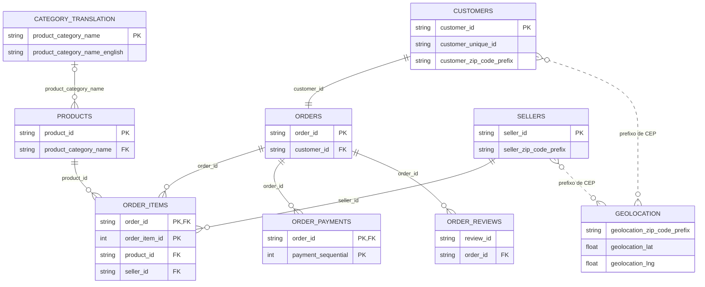

# DER — Olist

Modelo lógico das nove tabelas CSV em `dados/olist/`, relativo à raiz do Projeto E-commerce. Mostra chaves e relações necessárias para compreender os cruzamentos; não é um banco de dados com restrições ativas.

- `PK`: chave primária lógica. Duas colunas marcadas com PK na mesma tabela formam uma chave composta.
- `FK`: coluna usada para relacionar tabelas; os CSVs não impõem restrições de banco de dados.
- `||`: exatamente um; `o{` ou `}o`: zero ou muitos; `|o`: zero ou um.
- `CATEGORY_TRANSLATION` representa `product_category_name_translation.csv`. Os demais nomes abreviam `olist_*_dataset.csv`.
- A relação entre CUSTOMERS e ORDERS é 1:1 por `customer_id` nesta base. A mesma pessoa pode fazer várias compras, identificadas por `customer_unique_id`.
- As linhas pontilhadas de geolocalização representam correspondências por prefixo de CEP, não FKs para uma chave única: há várias linhas por prefixo nos dois lados.
- `review_id` se repete; não foi marcado como PK. A chave única das avaliações não foi estabelecida.
- Na conferência documental de 14/11/2026, as chaves compostas de itens e pagamentos não apresentaram duplicação. As verificações específicas e seus limites estão abaixo; isso não equivale a uma auditoria integral de todas as regras do domínio.

Ao juntar itens, pagamentos e avaliações por pedido, ou associar diretamente geolocalização, podem surgir múltiplas combinações de linhas. Agregue no nível da análise antes de calcular totais.

## Conferências na extração local — 14/11/2026

| Verificação | Resultado |
|---|---:|
| Repetições de `customer_id` em clientes e em pedidos | 0 em cada tabela |
| Repetições de `order_id`, `product_id` e `seller_id` nas respectivas tabelas | 0 em cada tabela |
| Repetições de (`order_id`, `order_item_id`) em itens | 0 |
| Repetições de (`order_id`, `payment_sequential`) em pagamentos | 0 |
| Repetições de `review_id` isolado | 814 linhas após a primeira ocorrência |
| Repetições de (`review_id`, `order_id`) | 0 |
| Repetições de categoria na tabela de tradução | 0 |

Não foram encontradas linhas sem correspondente nos vínculos pedidos → clientes, itens → pedidos/produtos/vendedores e pagamentos/avaliações → pedidos. A combinação (`review_id`, `order_id`) foi única nesta extração; `review_id` isolado não deve ser tratado como chave única. O diagrama mantém a distinção entre essa constatação e uma garantia de chave para dados futuros.

## Como as relações foram usadas na análise

1. Itens se relacionam a pedidos para selecionar vendas entregues, e a produtos para obter categorias.
2. Clientes fornecem `customer_unique_id` e destino. O vínculo 1:1 por `customer_id` não significa uma compra por pessoa: a pessoa é acompanhada por `customer_unique_id`.
3. Avaliações são consolidadas por pedido/recorte antes da média; pagamentos mantêm sua unidade até a seleção ou agregação adequada.
4. Vendedores são associados por itens, mas combinações pedido–vendedor são deduplicadas. O complemento de vendedor único é uma seleção, não uma mudança no relacionamento original.
5. A geolocalização e a tradução integram o modelo disponível, mas as correspondências por CEP e a tradução não foram usadas como junções para gerar os KPIs atuais. Coordenadas não foram usadas para calcular distâncias ou produzir mapa.

Os recortes e denominadores estão nos [Critérios dos indicadores](Crit%C3%A9rios%20dos%20indicadores.md). A conferência das relações não valida automaticamente datas, valores, cobertura ou causalidade.
