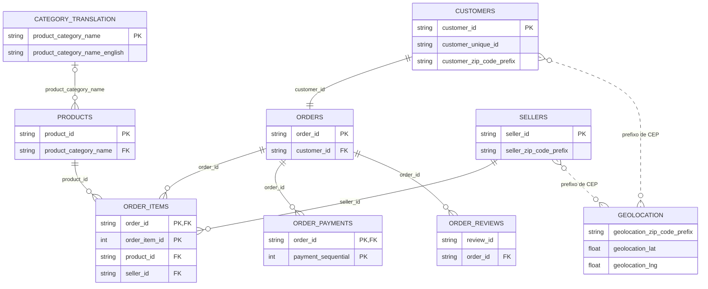

# DER — Olist

Modelo lógico das nove tabelas CSV em `C:\Users\User\Desktop\Projects\olist`, com as colunas necessárias para entender as relações.

- `PK`: chave primária lógica. Duas colunas marcadas com PK na mesma tabela formam uma chave composta.
- `FK`: coluna usada para relacionar tabelas; os CSVs não impõem restrições de banco de dados.
- `||`: exatamente um; `o{` ou `}o`: zero ou muitos; `|o`: zero ou um.
- `CATEGORY_TRANSLATION` representa `product_category_name_translation.csv`. Os demais nomes abreviam `olist_*_dataset.csv`.
- A relação entre CUSTOMERS e ORDERS é 1:1 por `customer_id` nesta base. A mesma pessoa pode fazer várias compras, identificadas por `customer_unique_id`.
- As linhas pontilhadas de geolocalização representam correspondências por prefixo de CEP, não FKs para uma chave única: há várias linhas por prefixo nos dois lados.
- `review_id` se repete; não foi marcado como PK. A chave única das avaliações não foi estabelecida.
- As chaves compostas de itens e pagamentos são propostas no modelo; sua unicidade não foi auditada. A integridade referencial completa também não foi auditada.

Ao juntar itens, pagamentos e avaliações por pedido, ou associar diretamente geolocalização, podem surgir múltiplas combinações de linhas. Agregue no nível da análise antes de calcular totais.
