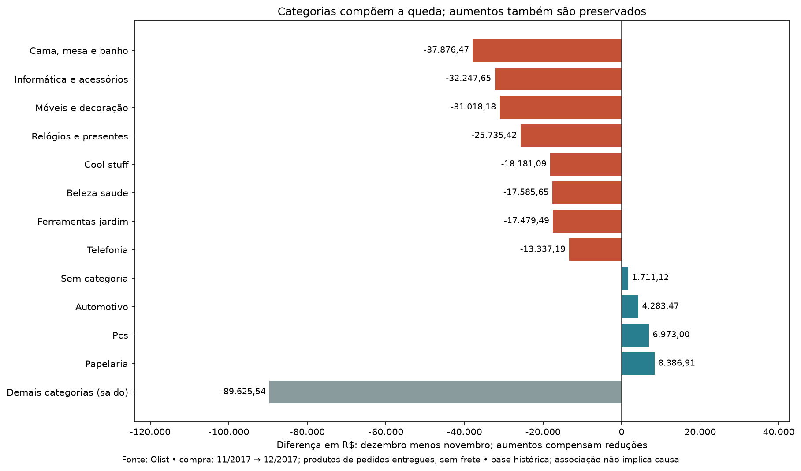

# Olist — vendas, entregas e experiência do cliente

Análise exploratória de dados de e-commerce com Python e pandas, apresentada em um relatório HTML com gráficos e tabelas de apoio.

## Resumo

O projeto investiga o desempenho comercial, os prazos de entrega e a experiência dos clientes na base pública Olist. O objetivo é transformar dados de pedidos, itens, clientes, avaliações e pagamentos em informações que ajudem gestores a selecionar problemas e oportunidades para investigação.

O foco está no caminho entre a pergunta e a conclusão: entender o que cada linha das tabelas representa, escolher os relacionamentos corretos, definir a população de cada indicador, validar os cálculos e comunicar os resultados com contexto. A análise relaciona valor vendido, volume de pedidos, ticket, frequência e duração dos atrasos, avaliações e recompra observada. As conclusões distinguem o que foi medido das explicações que ainda precisam ser investigadas.

**Tecnologias:** Python, pandas, Matplotlib e HTML/CSS.

**Entregas:** relatório local em HTML, oito figuras, tabelas CSV e documentação dos critérios de análise.

## Perguntas de negócio

- Como o valor vendido evoluiu e quanto dessa mudança acompanha o volume de pedidos e o ticket médio?
- Quais categorias contribuíram para a queda entre novembro e dezembro de 2017?
- Quais estados e meses concentram entregas atrasadas? Qual é a duração desses atrasos?
- Como os intervalos entre compra, aprovação, transporte e entrega variam nos grupos investigados?
- Quais destinos combinam exposição comercial relevante, atraso e maior proporção de frete?
- Como comparar vendedores considerando quantidade de pedidos, destino, período e tamanho dos grupos?
- Como as avaliações se relacionam com a situação final da entrega e o momento em que a resposta foi registrada?
- Quantos clientes fizeram múltiplos pedidos, compraram em dias diferentes ou voltaram em até 90 dias?
- Como o parcelamento se relaciona com o valor pago e com as categorias dos pedidos?

## Como a análise foi construída

### 1. Partir da pergunta e definir o indicador

Cada tema foi associado a uma pergunta de gestão. Antes de calcular os indicadores, foram definidos população, período, unidade de análise, fórmula e limites de interpretação.

Por exemplo, calcular a taxa de atraso exige datas de entrega real e prometida. Já o valor vendido depende dos itens de pedidos entregues e pode incluir pedidos sem data real de entrega. Por isso, os dois indicadores têm bases diferentes.

### 2. Entender as relações entre as tabelas

Um pedido pode ter vários itens, pagamentos, vendedores e avaliações. Fazer todas as junções diretamente no nível de item poderia repetir valores ou contar o mesmo pedido várias vezes.

Para evitar esse problema:

- Pedidos são contados por `order_id` distinto.
- Clientes são identificados por `customer_unique_id`; `customer_id` é utilizado nas relações com os pedidos.
- Preços e fretes são somados no nível dos itens.
- Avaliações são consolidadas por pedido antes das médias dos grupos.
- Relações pedido–vendedor são deduplicadas antes da contagem.
- Junções utilizam validação de cardinalidade, como `many_to_one` e `one_to_one`.

### 3. Investigar a qualidade dos dados

Foram examinados tipos, valores ausentes, identificadores repetidos, cobertura temporal e coerência das datas. As análises incluem verificações com `assert` e reconciliações entre os totais de origem e os agrupamentos.

Oito pedidos entregues ficaram fora da análise de prazo por ausência da data real, mas permaneceram nas vendas. Produtos sem categoria foram preservados no grupo **“Sem categoria”**. Atrasos extremos não foram excluídos automaticamente.

Nos intervalos logísticos, pares de datas ausentes ou com duração negativa são contados separadamente e ficam fora das estatísticas de duração daquele intervalo.

### 4. Construir comparações com contexto

Os indicadores foram analisados em conjunto:

- **Valor vendido, pedidos e ticket**, para decompor o desempenho comercial.
- **Quantidade, taxa e duração dos atrasos**, para distinguir alcance, frequência e severidade.
- **Avaliação e momento da resposta**, para separar registros feitos durante a espera e na entrega ou depois.
- **Múltiplos pedidos e recompra em outro dia**, com uma janela de observação definida.
- **Parcelamento, média, mediana e quantidade**, para contextualizar grupos pequenos.

A comparação mensal principal de vendas usa fevereiro de 2017 a julho de 2018, devido às limitações dos meses das extremidades. Outros indicadores utilizam a base histórica selecionada ou recortes explicitados em cada análise.

### 5. Levar os resultados ao HTML

As tabelas calculadas alimentam os gráficos e o gerador do relatório. A apresentação reúne descobertas, números essenciais, evidências e próximos passos de investigação. O detalhamento técnico e os CSVs permitem consultar os resultados além da síntese principal.


## Módulos e cálculos principais

Parte da análise é executada diretamente nos módulos, com operações do pandas. Nem todo tema foi encapsulado em uma função própria.

| Módulo | Papel na análise | Indicadores e resultados utilizados |
|---|---|---|
| [`clientes.py`](analises/clientes.py) | Carrega a dimensão de clientes, utilizada pelos demais módulos para relacionar pedidos a pessoas e destinos. | Identificação por `customer_unique_id`, clientes distintos e estado de destino. As contagens são feitas nos módulos consumidores. |
| [`entregas.py`](analises/entregas.py) | Seleciona pedidos com prazo avaliável, compara os dias real e prometido e analisa destinos, meses e etapas. | Taxa de atraso, dias após o prazo, mediana, percentil 90, faixas de severidade e intervalos logísticos. |
| [`vendas.py`](analises/vendas.py) | Relaciona itens a pedidos entregues e produtos, preservando categorias ausentes. | Valor vendido, pedidos distintos, ticket, itens por pedido, preço médio por item e contribuição das categorias. |
| [`geo.py`](analises/geo.py) | Agrupa os itens pelo destino e reúne os resultados comerciais e logísticos estaduais. | Participação nas vendas, clientes, ticket, frete médio, proporção de frete e taxa de atraso. |
| [`avaliacoes.py`](analises/avaliacoes.py) | Carrega as avaliações, converte datas e classifica o momento da resposta. | Qualidade das datas e classificação temporal das avaliações. |
| [`satisfacao_fidelizacao.py`](analises/satisfacao_fidelizacao.py) | Consolida notas por pedido e recorte; identifica múltiplos pedidos e retorno em outro dia. | Notas médias, cobertura, sobreposição de grupos, clientes com múltiplos pedidos e recompra em 90 dias. |
| [`vendedores.py`](analises/vendedores.py) | Constrói associações pedido–vendedor e comparações com exposição declarada. | Quantidade e taxa de atrasos, tamanho das bases e referência dos demais vendedores na mesma UF/trimestre. |
| [`pagamentos.py`](analises/pagamentos.py) | Analisa formas de pagamento e seleciona pedidos com pagamento único no cartão para comparar parcelas. | Participação no valor pago, quantidade, média e mediana por parcelas e participação dentro da categoria. |

### Funções próprias de análise

| Função | Lógica e finalidade |
|---|---|
| `classificar_momento(registros)` | Compara a resposta registrada com a entrega. Classifica avaliações anteriores à entrega, na entrega ou depois e casos não classificáveis. Nas anteriores, identifica respostas após o dia prometido. |
| `calcular_recompra(pedidos, corte)` | Organiza as datas distintas de compra por cliente, identifica a primeira compra observada e a primeira posterior em outro dia. Calcula elegibilidade e retorno entre 1 e 90 dias, inclusive. |
| `calcular_contribuicoes(dados)` | Agrupa valor dos produtos por categoria e mês, compara novembro e dezembro de 2017 e calcula a diferença monetária. Mantém categorias sem vendas em um dos meses e preserva contribuições positivas e negativas. |

### Operações do pandas que sustentam os KPIs

| Operação | Aplicação no projeto |
|---|---|
| `read_csv()` e `to_datetime()` | Leitura das fontes e conversão de datas para permitir comparações e durações. |
| `merge(..., validate=...)` e `join()` | Relacionamento entre tabelas, com verificação das cardinalidades declaradas. |
| `drop_duplicates()` e `nunique()` | Contagem de pedidos, clientes e associações sem confundir linhas de itens com compras. |
| `groupby().agg()` | Construção dos resumos por mês, estado, categoria, vendedor e situação da entrega. |
| `dt.normalize()`, `dt.days` e `dt.total_seconds()` | Comparação por dia no prazo e medição de intervalos em dias inteiros ou fracionários, conforme a pergunta. |
| `pct_change()` | Variação relativa das vendas e de seus componentes entre períodos. |
| `median()`, `quantile()` e `pd.cut()` | Distribuição e severidade dos atrasos, com mediana, percentil 90 e faixas. |
| `fillna('Sem categoria')` | Preservação dos valores associados a produtos sem classificação. |

### Funções de apresentação e rastreabilidade

- `criar_grafico_*()`: os geradores em `graficos/` produzem oito figuras a partir das tabelas calculadas.
- `descobertas()`: organiza as sínteses que destacam os resultados no relatório.
- `tabela()` e `figura()`: montam tabelas, downloads, imagens e legendas no HTML.
- `gerar_relatorio()`: reúne as seções e grava `web/index.html`.
- `registrar_base()`: registra hashes SHA-256 dos CSVs, quantidades de linhas, intervalos de datas e totais de referência.
- `main()`: coordena a geração das figuras e do relatório e, por padrão, abre a página no navegador.

## KPIs e principais descobertas

### Dimensão da base selecionada

| Indicador | Resultado | Definição |
|---|---:|---|
| Pedidos entregues | 96.478 | Pedidos com status `delivered`. |
| Itens vendidos | 110.197 | Itens associados aos pedidos entregues. |
| Valor dos produtos | R$ 13.221.498,11 | Soma de `price`, sem frete. |
| Pedidos com prazo avaliável | 96.470 | Entregues com datas real e prometida disponíveis. |
| Pedidos atrasados | 6.534 | Entrega após o dia prometido; entrega no próprio dia é considerada no prazo. |
| Taxa de atraso | 6,77% | Atrasados ÷ pedidos com prazo avaliável. |
| Mediana dos atrasos | 7 dias | Somente pedidos atrasados. |
| Percentil 90 dos atrasos | 22 dias | 90% dos atrasados tiveram atraso de até esse número de dias. |

As compras entregues observadas vão de 15/09/2016 a 29/08/2018. Esse intervalo não comprova cobertura completa de todos os dias ou da operação.

### 1. A queda comercial tem componentes identificáveis

De novembro para dezembro de 2017, o valor dos produtos caiu **26,50%**, acompanhado de redução de **24,37% nos pedidos** e **2,82% no ticket médio**.

Cama, mesa e banho; informática e acessórios; e móveis e decoração somaram **R$ 101.142,30 em reduções**, equivalentes a **38,64% da queda líquida de R$ 261.732,18**. Os aumentos de outras categorias foram preservados na decomposição.



### 2. Taxa e quantidade apontam prioridades diferentes

SP e RJ concentram **50,73% dos pedidos atrasados**. No RJ, as compras de fevereiro e março de 2018 reuniram **597 atrasos em 1.743 pedidos avaliáveis**, taxa conjunta de **34,25%**.

No mesmo episódio, a mediana entre entrega ao transportador e entrega ao cliente foi de **11,75 dias nos pedidos no prazo**, **34,14 dias nos atrasados** e **61,45 dias no grupo com atraso acima de 30 dias**. Os grupos ajudam a localizar diferenças de espera; não identificam, isoladamente, sua causa.

### 3. O momento da avaliação muda sua interpretação

Entre pedidos que terminaram atrasados, as avaliações registradas durante a espera após o prazo tiveram nota média **1,63**, em **4.431 pedidos**. Na entrega ou depois, a média foi **3,72**, em **1.908 pedidos**.

São grupos diferentes, com alguma sobreposição de pedidos. A comparação não demonstra que a nota do mesmo cliente melhorou após o recebimento.

### 4. Múltiplos pedidos não equivalem a recompra em outro dia

Foram identificados **2.801 clientes com múltiplos pedidos entregues**, dos quais **2.015 compraram em dias diferentes**. Entre **75.387 clientes com janela observável de 90 dias**, **978 retornaram em outro dia dentro dessa janela: 1,30%**.

### 5. Parcelamento precisa ser lido dentro do recorte

No complemento de pagamento único no cartão e categoria única, relógios e presentes em oito parcelas reuniu **687 pedidos**, correspondentes a **16,01% dos pedidos** e **29,04% do valor pago da categoria**. O valor pago pode incluir frete. Essa associação não comprova que oferecer mais parcelas aumenta as vendas.

## Como a análise pode apoiar gestores e donos de empresas

O projeto é um estudo de portfólio com dados históricos. Sua contribuição demonstrada é organizar evidências e prioridades; não houve medição de impacto operacional após uma intervenção em empresa.

| Público ou necessidade | Contribuição da análise | Decisão ou investigação apoiada |
|---|---|---|
| Donos e direção | Reúne desempenho comercial, exposição logística e experiência do cliente em uma apresentação. | Escolher quais problemas merecem aprofundamento antes de comprometer recursos. |
| Gestão comercial | Separa mudanças em pedidos, ticket e categorias. | Investigar produtos e composição das vendas nos segmentos de maior contribuição para uma queda. |
| Gestão de logística | Relaciona volume, taxa, severidade e etapas da entrega. | Priorizar destinos e episódios para examinar ocorrências e definição dos prazos prometidos. |
| Gestão de vendedores | Mostra o tamanho das bases e compara vendedor único com os demais na mesma UF/trimestre. | Selecionar casos para investigação contextualizada, sem penalizar automaticamente quem tem taxa alta em poucos pedidos. |
| Atendimento e experiência | Distingue avaliações durante a espera e na entrega ou depois. | Investigar a jornada e a comunicação com clientes que ainda aguardavam o pedido após o prazo. |
| Relacionamento com clientes | Separa múltiplos pedidos de retorno em outro dia, com janela declarada. | Definir uma base de acompanhamento para futuras análises de recompra e coortes. |
| Gestão de pagamentos | Identifica combinações de categoria e parcelas com volume e valor relevantes. | Investigar a composição das compras antes de avaliar mudanças nas condições de pagamento. |

## Limitações

- **Base histórica e cobertura:** os resultados descrevem a extração disponível e não representam necessariamente a operação atual. Meses de borda e clientes com acompanhamentos diferentes exigem cuidado.
- **Seleção por status:** as análises principais usam pedidos entregues. Pedidos cancelados, indisponíveis ou ainda não entregues não compõem os mesmos indicadores; atrasos em aberto ficam fora da taxa de entregas concluídas.
- **Associação e responsabilidade:** diferenças entre grupos não comprovam causalidade. Estado de destino, vendedor associado e duração de uma etapa não identificam automaticamente o responsável pelo atraso.
- **Resultados financeiros:** valor dos produtos não é lucro, margem nem receita própria da plataforma. Faltam custos e informações operacionais para avaliar rentabilidade ou retorno de uma intervenção.
- **Avaliações:** datas são tratadas como registros da base. Pedidos podem ter várias avaliações e aparecer em mais de um recorte; a comparação não acompanha necessariamente a evolução individual da nota.
- **Recompra:** utiliza compras entregues observadas em dias diferentes e somente clientes elegíveis para a janela de 90 dias. Não mede lealdade nem exige que a primeira entrega tenha ocorrido antes da segunda compra.
- **Comparabilidade:** grupos de vendedor, destino e período podem ter poucos pedidos e composição diferente. O complemento trimestral é descritivo e seleciona dez vendedores; não constitui ranking ajustado de desempenho.
- **Pagamentos:** o complemento por categoria exclui pedidos multicategoria e múltiplos registros de pagamento. Seus percentuais não representam toda a base comercial.
- **Representação numérica:** valores monetários são processados com a representação numérica existente no pandas; reconciliações toleram pequenas diferenças de ponto flutuante e não constituem auditoria contábil.
- **Apresentação conhecida:** na versão atual, a tabela de apoio de recompra no HTML exibe a taxa arredondada como “1”, sem o formato percentual adequado. O texto principal informa 1,30%, e o CSV conserva o valor calculado. Algumas anotações e a leitura em telas menores ainda precisam de conferência visual.

## Possíveis próximos passos

A versão atual está encerrada como entrega de portfólio. Em uma evolução futura, seria possível:

1. Consolidar trechos repetidos, corrigir a formatação da tabela de recompra e conferir a apresentação em desktop e celular.
2. Investigar os produtos e buscar dados de estoque, disponibilidade e campanhas para explicar a mudança comercial de novembro/dezembro.
3. Relacionar os episódios logísticos a registros de transporte e ocorrências, antes de escolher uma intervenção.
4. Comparar recompra por coortes com janelas equivalentes e, com desenho adequado, investigar sua relação com a experiência de entrega.
5. Incorporar custos e margens, caso disponíveis, para avaliar a viabilidade econômica das ações propostas.

Esses itens são possibilidades, não análises já realizadas ou compromissos de implementação.

## Estrutura do projeto

```text
Projeto E-commerce/
├── analises/                 # Preparação, regras e indicadores
├── dados/olist/              # CSVs de origem
├── Estrutura_de_pensamento/  # Perguntas, relacionamentos e metodologia
├── graficos/                 # Geração das figuras
├── web/
│   ├── imagens/             # Oito figuras geradas
│   ├── tabelas/             # CSVs derivados e manifesto da base
│   ├── index.html          # Relatório gerado
│   ├── relatorio.py        # Montagem das descobertas e da página
│   └── style.css           # Estilo da apresentação
├── main.py                  # Execução integrada
├── requirement.txt          # Dependências do ambiente
└── LICENSE
```

## Como consultar e executar

Para consultar a entrega existente, abra [`web/index.html`](web/index.html) em um navegador local. O repositório contém a página estática; não é necessário iniciar um servidor para essa consulta.

Para regenerar os resultados:

1. Disponibilize os CSVs da base Olist em `dados/olist/`, preservando os nomes originais. Os módulos usam arquivos como `olist_orders_dataset.csv`, `olist_order_items_dataset.csv`, `olist_customers_dataset.csv` e as demais tabelas da extração.
2. Na raiz do projeto, crie um ambiente virtual e instale as dependências. O arquivo existente se chama **`requirement.txt`**, no singular.
3. Execute `main.py` para gerar figuras, tabelas e relatório.

Exemplo no PowerShell:

```powershell
python -m venv .venv
.\.venv\Scripts\python.exe -m pip install -r requirement.txt
.\.venv\Scripts\python.exe main.py
```

Para gerar sem abrir o navegador:

```powershell
.\.venv\Scripts\python.exe main.py --sem-abrir
```

A execução sobrescreve as saídas derivadas em `web/`, preservando os CSVs de origem. Os módulos analíticos executam seus cálculos e verificações durante a importação.

**Ambiente local conferido:** Python 3.14.10, pandas 3.1.0 e Matplotlib 3.11.2. A instalação em um ambiente novo não foi validada nesta documentação.

## Fonte e documentação

- Dados: [Brazilian E-Commerce Public Dataset by Olist — Kaggle](https://www.kaggle.com/datasets/olistbr/brazilian-ecommerce).
- [Perguntas de negócio](Estrutura_de_pensamento/Perguntas.md).
- [Critérios dos indicadores](Estrutura_de_pensamento/Crit%C3%A9rios%20dos%20indicadores.md).
- [Relacionamentos entre as tabelas](Estrutura_de_pensamento/Diagrama%20de%20rela%C3%A7%C3%A3o%20das%20tabelas.md).
- [Manifesto dos CSVs e intervalos observados](web/tabelas/versao_base.csv).
- [Totais de referência](web/tabelas/referencia.csv).

O código está sob a [licença MIT](LICENSE). A reutilização dos dados deve observar as condições da fonte original.
